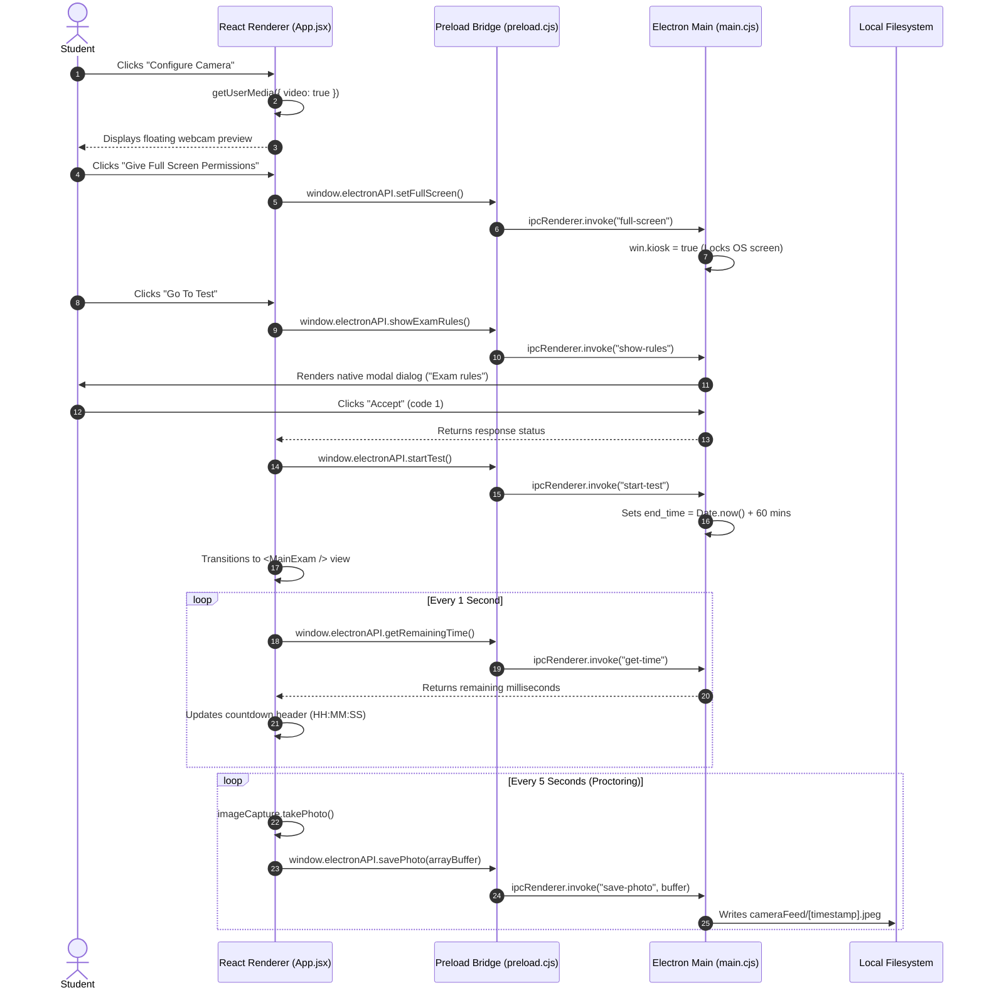

# Athena Exam Desktop Application

A secure, proctored desktop examination application built with **Electron**, **React**, and **Vite**. The application combines native OS lockdown capabilities (frameless kiosk window, native modal dialogs, and periodic background webcam snapshot capture) with a modern React single-page examination interface.

---

## Table of Contents

- [Project Overview](#project-overview)
- [Architecture & Technical Design](#architecture--technical-design)
  - [Process Model & Security Guarantees](#process-model--security-guarantees)
  - [Inter-Process Communication (IPC) Flow](#inter-process-communication-ipc-flow)
- [Implemented Features & Mechanics](#implemented-features--mechanics)
  - [1. Pre-flight Permissions & Setup](#1-pre-flight-permissions--setup)
  - [2. Camera Access & Floating Preview](#2-camera-access--floating-preview)
  - [3. Background Proctoring Snapshots](#3-background-proctoring-snapshots)
  - [4. Kiosk Mode & Fullscreen Lockdown](#4-kiosk-mode--fullscreen-lockdown)
  - [5. Native Code of Conduct Rules Dialog](#5-native-code-of-conduct-rules-dialog)
  - [6. Authoritative Exam Timer Synchronization](#6-authoritative-exam-timer-synchronization)
  - [7. MCQ Questionnaire Interface & Navigation](#7-mcq-questionnaire-interface--navigation)
- [Directory Structure](#directory-structure)
- [Electron IPC API Reference](#electron-ipc-api-reference)
- [Prerequisites & System Requirements](#prerequisites--system-requirements)
- [Installation & Setup](#installation--setup)
- [Running the Application](#running-the-application)
- [Implementation Status & Roadmap](#implementation-status--roadmap)
  
---

## Project Overview

The **Athena Exam Desktop Application** provides an academic testing environment that prevents candidates from switching tabs, opening developer utilities, or navigating outside the testing container while taking high-stakes multiple-choice assessments.

The application operates across two distinct domains:
1. **Desktop Native Shell (Electron):** Manages window framing, system-level fullscreen kiosk lockdown, proctoring camera frame persistence, native dialog prompts, and authoritative server/process timestamps.
2. **Client Interface (React + Vite):** Delivers a clean, distraction-free user experience styled with pure CSS design tokens, offering candidate permission onboarding, live webcam status, and interactive questionnaire navigation.

---

## Architecture & Technical Design

### Process Model & Security Guarantees

Electron executes JavaScript in two separate environments: the **Main Process** (Node.js runtime with full OS access) and the **Renderer Process** (Chromium browser sandbox rendering HTML/CSS/React).

```
┌────────────────────────────────────────────────────────┐
│               ELECTRON MAIN PROCESS                    │
│                 (electron/main.cjs)                    │
│   • BrowserWindow Management (Kiosk, Frameless)        │
│   • Local Filesystem IO (electron/cameraFeed/)         │
│   • Authoritative Exam Epoch Countdown Timer           │
│   • Native System Dialogs (dialog.showMessageBox)      │
└───────────────────────────┬────────────────────────────┘
                            │
               contextBridge.exposeInMainWorld
             (Preload: electron/preload.cjs)
                            │
                            ▼
┌────────────────────────────────────────────────────────┐
│              REACT RENDERER PROCESS                    │
│                     (Vite 8 + React 19)                │
│   • Pre-flight Permission Checklist (App.jsx)          │
│   • Floating Webcam Stream (HTML5 Video Element)       │
│   • Background Snapshot Capture (ImageCapture API)     │
│   • Interactive MCQ Questionnaire (MainExam.jsx)       │
└────────────────────────────────────────────────────────┘
```

#### Security Configuration:
- **`contextIsolation: true`:** Prevents scripts running in the renderer window from gaining direct access to Node.js internals or the Electron internal prototype tree.
- **`nodeIntegration: false`:** Guarantees that third-party web libraries or remote content cannot call `require()`, execute shell commands, or access the local file system.
- **Explicit API Surface:** Only functions explicitly exposed on `window.electronAPI` inside [`electron/preload.cjs`](file:///Users/amanrajsharma/Desktop/Projects_Final/Desktop_Application/electron/preload.cjs) can trigger main process IPC routines.

---

### Inter-Process Communication (IPC) Flow



---

## Implemented Features & Mechanics

### 1. Pre-flight Permissions & Setup
- Located in [`src/App.jsx`](file:///Users/amanrajsharma/Desktop/Projects_Final/Desktop_Application/src/App.jsx).
- Displays a card-based permission dashboard styled with the original Athena UI specifications.
- Prompts the candidate to complete both required steps (Camera configuration and Fullscreen lockdown) before unlocking the examination entry point.

### 2. Camera Access & Floating Preview
- Uses the standard WebRTC API: `navigator.mediaDevices.getUserMedia({ video: true })`.
- Streams the video feed into an HTML5 `<video>` element with `autoPlay` and `muted` attributes.
- Displays a floating preview in the top-right corner (`.video-preview`) during the onboarding phase so candidates can verify room lighting and framing.

### 3. Background Proctoring Snapshots
- Once camera access is granted, the app initializes the W3C `ImageCapture` API on the active video track: `new ImageCapture(track)`.
- When the exam starts (`started === true`), an active interval fires every **5000 milliseconds**.
- The video element CSS class changes from `.video-preview` to `.hidden-video` (`width: 1px`, `height: 1px`, `opacity: 0`, positioned off-screen at `-100px, -100px`). This keeps the DOM node mounted and the hardware stream active without distracting the candidate.
- The snapshot is converted to an `ArrayBuffer` in the renderer, passed over the IPC bridge, converted into a `Buffer` on the main process, and written synchronously to `electron/cameraFeed/[timestamp].jpeg`.
- If the `cameraFeed/` directory does not exist, the main process creates it recursively on demand (`fs.mkdirSync(feedDir, { recursive: true })`).

### 4. Kiosk Mode & Fullscreen Lockdown
- Triggered by calling `window.electronAPI.setFullScreen()`.
- The main process sets `win.kiosk = true` on the primary `BrowserWindow`.
- **Kiosk Mechanics:** Unlike standard HTML fullscreen (`requestFullscreen()`), Electron's kiosk mode locks out desktop window controls, hides the macOS dock / Windows taskbar, and disables standard operating system window switching shortcuts.
- **Escape / Exit Behavior:** In accordance with OnlyAditya's original implementation, no exit keybind (e.g., Escape) is exposed to the candidate. Exiting kiosk mode requires finishing the test, reloading the application window, or terminating the desktop process.

### 5. Native Code of Conduct Rules Dialog
- Before entering the assessment, the candidate clicks **Go To Test**.
- Calling `window.electronAPI.showExamRules()` invokes Electron's `dialog.showMessageBox()`.
- Renders an OS-native modal dialog with two options:
  - **Cancel** (`index 0`)
  - **Accept** (`index 1`)
- The exam transitions only after the modal is acknowledged, ensuring candidates confirm academic integrity terms before the clock starts.

### 6. Authoritative Exam Timer Synchronization
- Avoids client-side clock tampering by maintaining the target exam expiration timestamp on the Electron main process: `end_time = Date.now() + 60 * 60 * 1000` (1-hour standard duration).
- The renderer polls the main process every 1000ms using `window.electronAPI.getRemainingTime()`.
- Calculates remaining time using `Math.max(0, end_time - Date.now())` to prevent negative timestamps.
- Formatted via a zero-padded utility into a clean `HH:MM:SS` display.

### 7. MCQ Questionnaire Interface & Navigation
- Implemented in [`src/components/MainExam.jsx`](file:///Users/amanrajsharma/Desktop/Projects_Final/Desktop_Application/src/components/MainExam.jsx).
- Displays the exam status header, real-time countdown timer, and active question progress (`Question X of Y`).
- Provides radio-button option selection with responsive hover and checked states.
- Implements bounded pagination buttons (**Previous** disabled on question 1; **Next** disabled on the final question).
- Includes an **End Test** button that returns the candidate to the setup screen.
- **Graceful Fallback:** If the external mock backend is unreachable, the component seamlessly serves a built-in 5-question baseline dataset covering Electron and web engineering concepts, ensuring the UI remains 100% interactive and testable offline.

---

## Directory Structure

```text
Desktop_Application/
├── .gitignore                   # Git rules ignoring logs, node_modules, build, and cameraFeed/
├── electron/
│   ├── cameraFeed/              # Automatically created directory storing captured JPEG frames
│   ├── main.cjs                 # Electron main process (Window, Kiosk, IPC, Dialog, Snapshot IO)
│   └── preload.cjs              # Isolated context bridge exposing window.electronAPI
├── public/
│   ├── favicon.svg              # Athena desktop favicon
│   └── icons.svg                # Application SVG symbol definitions
├── src/
│   ├── assets/                  # Hero branding illustrations and SVG logos
│   │   ├── hero.png
│   │   ├── react.svg
│   │   └── vite.svg
│   ├── components/
│   │   └── MainExam.jsx         # MCQ assessment container, options, and navigation controls
│   ├── App.css                  # 440+ lines of Athena UI stylesheets
│   ├── App.jsx                  # Main permissions dashboard, camera capture, and view router
│   ├── index.css                # Global CSS variables, layout tokens, and typography
│   └── main.jsx                 # React DOM root entry point
├── eslint.config.js             # ESLint configuration enforcing React hook safety
├── index.html                   # HTML template hosting the React mount element
├── INTEGRATION_MAP.md           # Granular file-by-file tracking table between source repos
├── package-lock.json            # Deterministic dependency lockfile
├── package.json                 # Project scripts and dependency declarations
├── PACKAGE_LOG.md               # Audit log of all installed dependencies and exact versions
├── README.md                    # Project documentation and developer reference
└── vite.config.js               # Vite bundler configuration using @vitejs/plugin-react
```

---

## Electron IPC API Reference

The preload bridge isolates the renderer process and exposes a safe `window.electronAPI` interface:

| Method Name | Channel Name | Parameters | Returns | Description |
| :--- | :--- | :--- | :--- | :--- |
| `setFullScreen()` | `"full-screen"` | `void` | `Promise<void>` | Enables native kiosk mode on the application window (`win.kiosk = true`). |
| `showExamRules()` | `"show-rules"` | `void` | `Promise<number>` | Triggers a blocking native system message box with exam guidelines; resolves with the clicked button index (`0` for Cancel, `1` for Accept). |
| `showRules()` | `"show-rules"` | `void` | `Promise<number>` | Backward-compatibility alias for `showExamRules()`. |
| `startTest()` | `"start-test"` | `void` | `Promise<number>` | Sets the authoritative exam expiration epoch timestamp on the main process (default: 60 minutes). |
| `getRemainingTime()` | `"get-time"` | `void` | `Promise<number>` | Returns remaining test duration in milliseconds (`end_time - Date.now()`). |
| `savePhoto(buffer)` | `"save-photo"` | `ArrayBuffer` | `Promise<Object>` | Writes camera snapshot bytes into `electron/cameraFeed/[timestamp].jpeg` on the local disk. |

---

## Prerequisites & System Requirements

- **Node.js:** `v18.0.0` or higher (verified on Node.js `v25.8.2`).
- **npm:** `v9.0.0` or higher (verified on npm `11.11.1`).
- **Operating System:**
  - macOS 11.0 (Big Sur) or higher (Apple Silicon & Intel).
  - Windows 10 / 11 (64-bit).
  - Linux (Ubuntu 20.04+, Debian 11+, Fedora 36+).
- **Hardware:** Webcam/Camera device required for proctoring checks.

---

## Installation & Setup

1. **Clone the repository:**
   ```bash
   git clone https://github.com/AmanRajSharma001/Desktop_Application.git
   cd Desktop_Application
   ```

2. **Install exact dependencies:**
   ```bash
   npm install
   ```

3. **Verify linting and build:**
   ```bash
   npm run lint
   npm run build
   ```

---

## Running the Application

### Option 1: Development Mode (Hot Module Replacement)

Run the Vite frontend development server and the Electron desktop application concurrently:

**Terminal 1 (Vite Dev Server on port 5173):**
```bash
npm run dev
```

**Terminal 2 (Electron Desktop Runtime):**
```bash
npm start
```

### Option 2: Standalone / Production Build Mode

Build the React frontend into static assets. The Electron main process contains an automatic fallback mechanism: if `http://localhost:5173/` is unavailable, it immediately loads [`dist/index.html`](file:///Users/amanrajsharma/Desktop/Projects_Final/Desktop_Application/dist/index.html).

```bash
# 1. Compile production bundle
npm run build

# 2. Launch the desktop application
npm start
```

---

## Implementation Status & Roadmap

### What Is Fully Implemented & Working Today
- [x] **Electron Process Shell:** Frameless desktop window with secure context isolation and disabled node integration.
- [x] **Preload Bridge:** Complete `window.electronAPI` interface with bidirectional IPC handling.
- [x] **Athena Design System:** Faithful preservation of all original styles, cards, buttons, fonts, and responsive layouts.
- [x] **Webcam Integration:** Real-time camera permissions, stream rendering, and floating preview box.
- [x] **Automated Proctoring Snapshots:** Periodic 5-second `ImageCapture` extraction, array buffer serialization, and filesystem saving to `electron/cameraFeed/`.
- [x] **Kiosk Mode Enforcement:** Native OS window lockdown via `win.kiosk = true`.
- [x] **Native Rules Dialog:** Modal confirmation dialog using Electron's `dialog.showMessageBox`.
- [x] **Synchronized Countdown Timer:** Server/process authoritative timestamp polling with zero timer drift.
- [x] **MCQ Navigation Shell:** Interactive question card with radio option selection, progress indicator, and pagination buttons.
- [x] **Offline Resilience:** Graceful local data fallback for all questionnaire views when network backend is absent.

### Remaining Work & Future Roadmap
- [ ] **Candidate Identity Onboarding:** Integrating student registration fields (`Name` and University Roll Number `URN`) from the JACOBIAN01 reference repository before starting the exam.
- [ ] **Integrated Express Backend Service:** Embedding or connecting the Express API service (`server.js`) to serve dynamic questions from `questions.json` and persist candidate sessions in `sessions.json`.
- [ ] **Answer Submission & Scoring Engine:** Recording selected option indices, evaluating answers against the question bank answer key, and calculating scores.
- [ ] **Summary & Results Dashboard:** Rendering an end-of-exam review screen showing questions attempted, correct answers, wrong answers, and overall percentage.
- [ ] **Electron Application Packager:** Configuring `electron-builder` to package standalone native installers (`.dmg` for macOS, `.exe` / NSIS for Windows, `.AppImage` for Linux).

---
