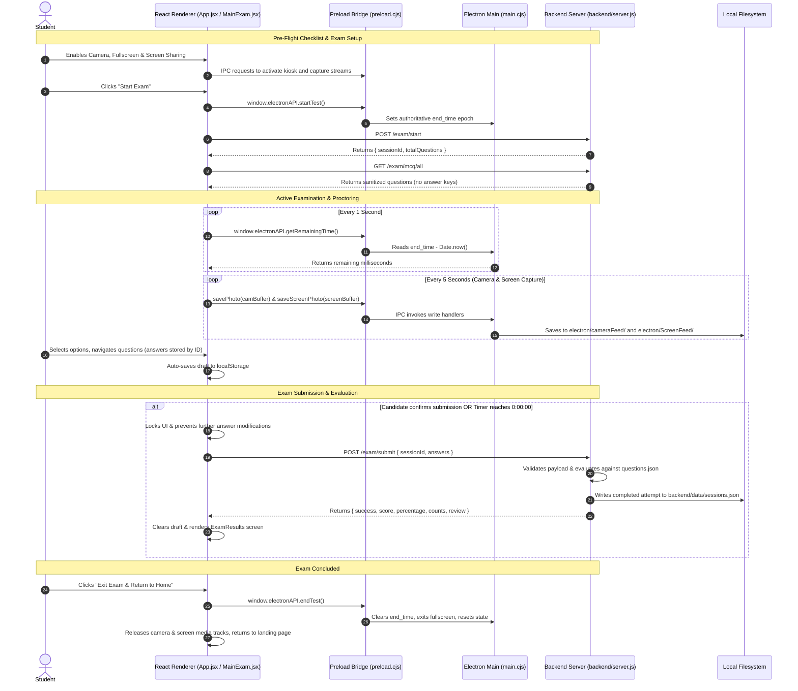

# Athena Exam Desktop Application

A secure, proctored desktop examination application built with **Electron**, **React**, **Vite**, and a lightweight, zero-dependency **Node.js backend service**. The application combines native OS lockdown capabilities (frameless kiosk window, native modal dialogs, real-time native fullscreen state verification, periodic background webcam snapshot capture, and mandatory screen sharing via Electron `desktopCapturer`) with a modern React single-page examination interface, trusted backend evaluation, and post-exam performance results.

**Status: Day 5 Completed — Fully Audited, End-to-End Tested (62/62 Passing), Hardened, and Release-Ready.**

---

## Table of Contents

- [Project Overview](#project-overview)
- [Architecture & Technical Design](#architecture--technical-design)
  - [Process Model & Three-Tier System Architecture](#process-model--three-tier-system-architecture)
  - [Inter-Process & Network Communication Flow](#inter-process--network-communication-flow)
- [Mandatory Exam Setup — Three-Way Pre-Flight Checklist](#mandatory-exam-setup--three-way-pre-flight-checklist)
  - [1. Camera Validation & Proctoring Snapshots](#1-camera-validation--proctoring-snapshots)
  - [2. Native Fullscreen & Kiosk Mode Lockdown](#2-native-fullscreen--kiosk-mode-lockdown)
  - [3. Mandatory Screen Sharing — desktopCapturer Integration](#3-mandatory-screen-sharing--desktopcapturer-integration)
  - [4. Escape Key Handling, Exit Detection & Controlled Recovery](#4-escape-key-handling-exit-detection--controlled-recovery)
  - [5. Screen Sharing Loss During Active Exam](#5-screen-sharing-loss-during-active-exam)
- [Complete Exam Lifecycle, Submission & Results (Days 4 & 5)](#complete-exam-lifecycle-submission--results-days-4--5)
  - [1. Reliable Question Loading & Sanitization](#1-reliable-question-loading--sanitization)
  - [2. Answer Selection, Persistence & Question Palette](#2-answer-selection-persistence--question-palette)
  - [3. Local Draft Persistence (localStorage Auto-Save)](#3-local-draft-persistence-localstorage-auto-save)
  - [4. Submission Triggers & Confirmation Modal](#4-submission-triggers--confirmation-modal)
  - [5. Duplicate Submission & Concurrency Guard](#5-duplicate-submission--concurrency-guard)
  - [6. Authoritative Timer Expiration & Auto-Submission](#6-authoritative-timer-expiration--auto-submission)
  - [7. Trusted Backend Evaluation & Scoring Engine](#7-trusted-backend-evaluation--scoring-engine)
  - [8. Post-Exam Results & Performance Review Screen](#8-post-exam-results--performance-review-screen)
  - [9. Teardown, Cleanup & Resource Deallocation](#9-teardown-cleanup--resource-deallocation)
  - [10. Submission Failure Handling & Answer Preservation](#10-submission-failure-handling--answer-preservation)
- [Backend Service & API Reference](#backend-service--api-reference)
  - [Backend Architecture & Data Stores](#backend-architecture--data-stores)
  - [REST API Endpoints](#rest-api-endpoints)
- [Directory Structure](#directory-structure)
- [Electron IPC API Reference](#electron-ipc-api-reference)
- [macOS Permissions Required](#macos-permissions-required)
- [macOS Screen Recording Permission](#macos-screen-recording-permission)
- [Prerequisites & System Requirements](#prerequisites--system-requirements)
- [Installation & Setup](#installation--setup)
- [Running the Application](#running-the-application)
- [Building & Release Preparation](#building--release-preparation)
- [Verification & Automated Test Suite](#verification--automated-test-suite)
- [Known Limitations](#known-limitations)
- [Implementation Status & Release Readiness](#implementation-status--release-readiness)

---

## Project Overview

The **Athena Exam Desktop Application** provides a tamper-resistant academic testing environment that prevents candidates from switching tabs, opening developer utilities, or navigating outside the testing container while taking high-stakes multiple-choice assessments.

The application operates across three coordinated domains:

1. **Desktop Native Shell (Electron):** Manages window framing, system-level fullscreen kiosk lockdown, mandatory screen sharing via `desktopCapturer`, proctoring camera frame persistence, proctoring screen capture persistence, native dialog prompts, authoritative countdown timestamps, and bidirectional window state monitoring.
2. **Client Interface (React + Vite):** Delivers a clean, distraction-free user experience styled with pure CSS design tokens, offering candidate permission onboarding, live webcam status, screen-sharing source selection, fullscreen and screen-sharing recovery overlays, interactive questionnaire navigation with answer persistence, submission confirmation modals, and a post-exam results screen.
3. **Evaluation Backend (Node.js Service):** A lightweight, zero-dependency HTTP service on port 3000 that manages the canonical question bank, enforces confidentiality by stripping correct answer keys before client transmission, tracks exam session attempts in persistent storage (`backend/data/sessions.json`), and authoritatively computes candidate scores upon submission.

---

## Architecture & Technical Design

### Process Model & Three-Tier System Architecture

Electron executes JavaScript in two separate environments: the **Main Process** (Node.js runtime with full OS access) and the **Renderer Process** (Chromium browser sandbox rendering HTML/CSS/React), communicating with an independent **Evaluation Backend**.

```
┌─────────────────────────────────────────────────────────────┐
│               ELECTRON MAIN PROCESS                         │
│                 (electron/main.cjs)                         │
│   • BrowserWindow Native Fullscreen / Kiosk Lockdown        │
│   • Native Window Event Monitoring (enter/leave FS)         │
│   • Controlled Fullscreen Recovery & IPC Broadcast          │
│   • desktopCapturer.getSources() — screen source listing    │
│   • macOS Screen Recording permission check                 │
│   • Local Filesystem IO (electron/cameraFeed/)              │
│   • Local Filesystem IO (electron/ScreenFeed/)              │
│   • Authoritative Exam Epoch Countdown Timer                │
│   • Native System Dialogs (dialog.showMessageBox)           │
└───────────────────────────┬─────────────────────────────────┘
                            │
               contextBridge.exposeInMainWorld
              (Preload: electron/preload.cjs)
                            │
                            ▼
┌─────────────────────────────────────────────────────────────┐
│              REACT RENDERER PROCESS                         │
│                     (Vite 8 + React 19)                     │
│   • 3-Way Mandatory Pre-flight Checklist (App.jsx)          │
│   • Floating Webcam Stream (HTML5 Video Element)            │
│   • Background Camera Proctoring Snapshots (5s Interval)    │
│   • Background Screen Proctoring Snapshots (5s Interval)    │
│   • Source Picker Modal (desktopCapturer thumbnails)        │
│   • Fullscreen & Screen Sharing Recovery Blocking Overlays  │
│   • Dynamic Question Palette & Answer Persistence (MainExam)│
│   • Submission Modal with Answered/Unanswered Breakdown     │
│   • Results Dashboard with Score, Breakdown & Stats         │
└───────────────────────────┬─────────────────────────────────┘
                            │
                   HTTP REST API (Fetch)
                            │
                            ▼
┌─────────────────────────────────────────────────────────────┐
│               ATHENA EVALUATION BACKEND                     │
│                 (backend/server.js)                         │
│   • Zero-dependency Node.js HTTP Server on Port 3000        │
│   • GET /exam/mcq/all — Sanitized Questions Bank            │
│   • POST /exam/start — Session Initialization               │
│   • POST /exam/submit — Trusted Scoring & Evaluation        │
│   • GET /exam/session/:id — Attempt Retrieval               │
│   • Persistent Storage: backend/data/sessions.json          │
└─────────────────────────────────────────────────────────────┘
```

#### Security Configuration

- **`contextIsolation: true`:** Prevents scripts in the renderer from accessing Node.js internals or the Electron prototype tree.
- **`nodeIntegration: false`:** Guarantees third-party libraries cannot call `require()`, execute shell commands, or access the local filesystem.
- **Explicit API Surface:** Only functions explicitly exposed on `window.electronAPI` inside [`electron/preload.cjs`](file:///Users/amanrajsharma/Desktop/Projects_Final/Desktop_Application/electron/preload.cjs) can trigger main process IPC routines.
- **Answer Key Confidentiality:** Correct answer indices and explanations are never sent to the renderer during question fetching. Scoring is strictly performed on the backend upon submission.
- **Path Traversal Prevention:** `save-screen-photo` and `save-photo` IPC handlers use `path.basename()` on all supplied filenames; the renderer cannot specify arbitrary filesystem destinations.
- **Gitignore Protection:** Camera captures (`electron/cameraFeed/`), screen captures (`electron/ScreenFeed/`), and runtime session records are excluded from version control.

---

### Inter-Process & Network Communication Flow



---

## Mandatory Exam Setup — Three-Way Pre-Flight Checklist

Before candidates can access the exam questions, **all three** of the following conditions must be verified. The **Start Exam** button remains disabled until all three pass, and each condition is revalidated at the moment the button is clicked.

### 1. Camera Validation & Proctoring Snapshots

- **Hardware Acquisition:** `getUserMedia({ video: true })` — prior streams are stopped before requesting a new one.
- **Track Health Checks:** Asserts `getVideoTracks().length > 0` and `track.readyState === "live"`.
- **Proctoring Snapshots:** 5-second interval during the active exam using `ImageCapture.takePhoto()` with an `<canvas>` fallback.
- **Concurrency Guard:** `isCapturingRef` lock prevents overlapping snapshot operations.
- **Storage:** `electron/cameraFeed/[timestamp].jpeg` — written by the main process via `save-photo` IPC.
- **Cleanup:** Intervals cleared and tracks stopped on exam end or window unmount.

---

### 2. Native Fullscreen & Kiosk Mode Lockdown

- **macOS:** `win.setFullScreen(true)` + `win.setKiosk(true)`.
- **Windows / Linux:** `win.setKiosk(true)` + `win.setFullScreen(true)`.
- **Verification:** `win.isFullScreen() || win.isKiosk()` — state is queried, not assumed.

---

### 3. Mandatory Screen Sharing — desktopCapturer Integration

Screen sharing is a **mandatory** third prerequisite using Electron's `desktopCapturer` API in the main process and exposed to the renderer via a secure IPC bridge.

#### Workflow

1. Candidate clicks **"Enable Screen Sharing"** on the landing page.
2. Renderer calls `window.electronAPI.screenShare()` → IPC channel `"screen-share"`.
3. Main process calls `desktopCapturer.getSources({ types: ["screen", "window"] })`, sanitizes `NativeImage` objects into data URLs, and returns the list.
4. A **source-picker modal** appears with thumbnail previews of all available screens and windows.
5. Candidate clicks a source. Renderer calls:
   ```js
   navigator.mediaDevices.getUserMedia({
     video: { mandatory: { chromeMediaSource: "desktop", chromeMediaSourceId: source.id } }
   })
   ```
6. Renderer validates the returned stream has a live video track.
7. `screenShareStatus` is set to `"Ready"` and the source name is displayed.
8. `track.onended` is bound — if the candidate stops sharing from the OS UI, the application detects this immediately.

---

### 4. Escape Key Handling, Exit Detection & Controlled Recovery

- **Escape Interception:** `win.webContents.on("before-input-event")` intercepts Escape during active exam with `event.preventDefault()`.
- **Native Exit Monitoring:** `leave-full-screen` and `leave-html-full-screen` events trigger controlled recovery (1 auto-retry after 300ms).
- **Recovery Overlay:** If fullscreen cannot be restored, a blocking overlay appears — MCQ inputs disabled, timer continues, answers preserved.

---

### 5. Screen Sharing Loss During Active Exam

If the shared screen track ends while the exam is active:

- `screenTrack.onended` fires → `screenStreamRef` cleared → `screenShareStatus` → `"Not Ready"`.
- Both screenshot intervals are **suspended** (their `useEffect` dependency arrays include `screenShareStatus`).
- A **Screen Sharing Recovery Overlay** appears, blocking all MCQ interaction.
- **"Resume Screen Sharing"** opens the source-picker again.
- After the candidate selects a new source and the stream is validated, the overlay dismisses and intervals resume without duplication.
- Exam timer continues and all answers are preserved throughout.

---

## Complete Exam Lifecycle, Submission & Results (Day 4)

### 1. Reliable Question Loading & Sanitization

- Questions are loaded asynchronously via `GET http://localhost:3000/exam/mcq/all`.
- **Answer Key Security:** The server sanitizes the dataset before transmission, removing `correctAnswer` and `explanation` so answer keys cannot be discovered via browser DevTools.
- **Reliable Fallback:** If the backend server is unreachable or returns malformed data, the application transitions to explicit offline fallback mode, displaying a visual status badge (`▲ Offline Mode`) and preserving exam continuity.
- **Dynamic Question Count:** Total question count is derived dynamically from `questions.length` rather than hardcoded assumptions.

---

### 2. Answer Selection, Persistence & Question Palette

- **Stable ID Mapping:** Answers are mapped by question ID (`answers[questionId] = optionIndex`) rather than array index. Navigating forward or backward instantly restores the candidate's selected choice.
- **Question Palette:** A quick-navigation grid provides direct access to any question (1 to N) with live visual status:
  - **Blue Border:** Currently active question.
  - **Green Filled:** Answered question.
  - **Light Gray:** Unanswered question.
- **Live Metrics:** Real-time indicator tracks answered count (`X / Total`) and remaining unanswered questions.

---

### 3. Local Draft Persistence (localStorage Auto-Save)

- Every answer change is automatically serialized to `localStorage` under `athena_exam_draft`.
- In the event of an accidental window reload or UI interruption, draft answers and the session identifier are immediately restored on mount.
- On confirmed submission, the draft cache is cleanly wiped.

---

### 4. Submission Triggers & Confirmation Modal

Examination submission is initiated by either:
1. **Explicit Candidate Action:** Clicking **"End Test & Submit"** or **"Review & Submit"** opens a confirmation modal summarizing completion metrics (Answered, Unanswered, Total) and warns if questions remain unanswered.
2. **Authoritative Timer Expiration:** When the remaining exam time reaches zero (`00:00:00`), the client immediately locks answer inputs and auto-submits the exam payload.

---

### 5. Duplicate Submission & Concurrency Guard

- **Client Guard:** `isSubmittingRef.current` lock prevents concurrent submission requests from rapid button clicks or overlapping timer events. All inputs, options, and buttons are disabled immediately upon submission initiation.
- **Server Guard:** If a session identifier has already been evaluated and recorded as `"completed"`, `POST /exam/submit` returns an HTTP `409 Conflict` with the previously evaluated score, preventing double-marking.

---

### 6. Authoritative Timer Expiration & Auto-Submission

- The exam countdown is governed by an authoritative epoch timestamp stored in Electron's main process (`end_time`).
- The renderer synchronizes with the main process every 1 second.
- When `remaining <= 0`, `isTimeExpired` triggers an automatic submission request without destroying the component or losing candidate responses.
- The exam transitions directly to the results dashboard with an explanatory notice: *"Exam time has expired and your answers have been submitted."*

---

### 7. Trusted Backend Evaluation & Scoring Engine

- Scoring is strictly calculated in the trusted backend layer (`backend/server.js`).
- The server compares the submitted answers against the authoritative `correctAnswer` indices in `backend/data/questions.json`.
- The backend computes:
  - `score` (raw correct answer count)
  - `percentage` (`Math.round((score / totalQuestions) * 100)`)
  - `correctCount`, `incorrectCount`, `unansweredCount`
  - Itemized `review` list with each question's prompt, chosen option, correct option, and explanation.
- The completed attempt is appended to persistent storage at `backend/data/sessions.json`.

---

### 8. Post-Exam Results & Performance Review Screen

Upon receiving confirmation from the backend, [`src/components/ExamResults.jsx`](file:///Users/amanrajsharma/Desktop/Projects_Final/Desktop_Application/src/components/ExamResults.jsx) renders a comprehensive performance review:

- **Header Status:** Success icon with clear confirmation badge.
- **Score Hero Banner:** Large score display (`Score / Total`) and percentage badge.
- **Metrics Grid:** Card breakdown for Total Questions, Answered, Unanswered, Correct Answers, and Incorrect Answers.
- **Metadata Bar:** Displays Session ID, unique Submission ID (`sub_[timestamp]_[salt]`), and timestamp.
- **Question Breakdown:** Expandable review of each question:
  - Question text
  - Candidate's chosen answer
  - Correct answer (now safely revealed post-submission)
  - Color-coded status badge (`Correct (+1)`, `Incorrect (0)`, `Unanswered`)
  - Detailed explanatory note
- **Exit Action:** **"Exit Exam & Return to Home"** triggers complete application teardown.

---

### 9. Teardown, Cleanup & Immediate Interval Shutdown (Day 5)

As soon as exam submission succeeds (or auto-expires):
- **Immediate Capture Loop Shutdown:** Both 5-second camera snapshot and 5-second screen capture intervals are immediately cleared via `onExamSubmitted` callback. No further disk writes or screenshots occur while the candidate reviews results.
- **Lockdown Release:** Electron's kiosk lockdown is lifted via `window.electronAPI.endTest()`, enabling the candidate to read results without trapping the window.
- **Hardware Track Release:** Screen recording and camera tracks have their `onended` listeners detached and are stopped, releasing webcam and screen resources.
- **Return to Home:** When clicking **"Exit Exam & Return to Home"**, all state (`started`, `isExamSubmitted`, `time`) is reset to initial defaults.

---

### 10. Submission Failure Handling & Answer Preservation (Day 5)

The application handles network interruptions, server downtime, and failed submissions safely:
- **No Invented Scores:** The application never generates simulated scores or fake 100% / 0% results. It never reports `success: true` unless the trusted backend has confirmed and evaluated the submission.
- **Answer Preservation:** Candidate answers remain safely preserved in React component state and in `localStorage` (`athena_exam_draft`).
- **Manual Submission Failures:** If a candidate clicks submit while the server is unreachable, the confirmation modal remains accessible with a clear error alert: *"Failed to submit exam: [error details]. Your answers are safely preserved."* The candidate can retry submission immediately once connectivity is re-established.
- **Timer Expiry Failures:** If the timer reaches zero while the backend is temporarily offline, the application presents the Results screen in an unsubmitted state (`success: false`, `score: null`) with an explanatory alert and a prominent **"Retry Submission"** button. Clicking retry re-transmits the preserved answers to the backend without data loss.

---

## Backend Service & API Reference

### Backend Architecture & Data Stores

- **Runtime:** Native Node.js HTTP server (`backend/server.js`) — zero external npm dependencies.
- **Port:** Configurable via `process.env.PORT` (defaults to `3000`).
- **Data Stores:**
  - `backend/data/questions.json`: Authoritative question bank with 10 questions, option arrays, `correctAnswer` indices, and explanations.
  - `backend/data/sessions.json`: Persistent JSON store for candidate exam attempts and evaluation records.

### REST API Endpoints

| Method | Endpoint | Request Body | Response Format | Description |
| :--- | :--- | :--- | :--- | :--- |
| `GET` | `/health` | — | `{ status: "ok", service: "athena-backend", timestamp }` | Service healthcheck endpoint. |
| `GET` | `/exam/mcq/all` | — | `[ { id, question, options[] }, ... ]` | Returns all questions. Secret answer keys are stripped. |
| `GET` | `/exam/mcq/:id` | — | `{ id, question, options[] }` | Returns a single sanitized question by ID. |
| `POST` | `/exam/start` | `{ sessionId?, candidateName? }` | `{ success: true, sessionId, examId, startTime, durationMinutes, totalQuestions }` | Initializes an exam session. |
| `POST` | `/exam/submit` | `{ sessionId, answers: { [qId]: optionIdx }, candidateName? }` | `{ success: true, sessionId, submissionId, score, percentage, correctCount, incorrectCount, unansweredCount, review[] }` | Validates payload, evaluates answers against key, persists to `sessions.json`, and returns score. |
| `GET` | `/exam/session/:id` | — | `{ sessionId, submissionId, score, status, ... }` | Retrieves a recorded exam session attempt. |

---

## Directory Structure

```text
Desktop_Application/
├── .gitignore                        # Excludes node_modules, dist, cameraFeed/, ScreenFeed/, *.jpeg, *.jpg
├── backend/
│   ├── data/
│   │   ├── questions.json            # Authoritative question bank with answer keys
│   │   └── sessions.json             # Persistent exam submission store
│   └── server.js                     # Native Node.js HTTP backend server (port 3000)
├── electron/
│   ├── cameraFeed/                   # Camera proctoring snapshots (git-ignored)
│   ├── ScreenFeed/                   # Screen proctoring snapshots (git-ignored)
│   ├── main.cjs                      # Main process: fullscreen, desktopCapturer, IPC, timer, IO
│   ├── preload.js                    # Canonical preload — contextBridge with all Day 2 + Day 3 APIs
│   └── preload.cjs                   # CommonJS copy used by main.cjs at runtime
├── public/
│   ├── favicon.svg
│   └── icons.svg
├── src/
│   ├── assets/
│   │   ├── hero.png
│   │   ├── react.svg
│   │   └── vite.svg
│   ├── components/
│   │   ├── ExamResults.jsx           # Day 4: Post-exam results dashboard & question review
│   │   └── MainExam.jsx              # Day 4: MCQ lifecycle, answer persistence, submission modal
│   ├── App.css                       # Styling: statuses, recovery overlays, source picker, results
│   ├── App.jsx                       # 3-way pre-flight, screen sharing, camera, exam lifecycle
│   ├── index.css
│   └── main.jsx
├── test/
│   ├── exam_enforcement.test.js      # Day 2: 12 automated scenarios
│   ├── day3_screen_sharing.test.js   # Day 3: 18 automated scenarios
│   ├── day4_lifecycle_submission.test.js # Day 4: 12 automated scenarios (MCQ, submission, results)
│   └── day5_e2e_release.test.js      # Day 5: 20 comprehensive end-to-end verification scenarios
├── eslint.config.js
├── index.html
├── INTEGRATION_MAP.md
├── package-lock.json
├── package.json                      # Added npm run server script
├── PACKAGE_LOG.md
├── README.md
└── vite.config.js
```

---

## Electron IPC API Reference

| Method Name | Channel | Parameters | Returns | Description |
| :--- | :--- | :--- | :--- | :--- |
| `setFullScreen()` | `"full-screen"` | — | `Promise<Object>` | Activates native fullscreen + kiosk; returns verified state. |
| `exitFullScreen()` | `"exit-full-screen"` | — | `Promise<Object>` | Exits fullscreen + kiosk; returns verified state. |
| `getFullscreenStatus()` | `"get-fullscreen-status"` | — | `Promise<Object>` | Queries `isFullScreen()` and `isKiosk()`. |
| `onFullscreenChange(cb)` | `"fullscreen-changed"` | `Function` | `Function` | Subscribes to window state push events; returns unsubscribe function. |
| `showExamRules()` | `"show-rules"` | — | `Promise<number>` | Native modal — `1` = Accept, `0` = Cancel. |
| `showRules()` | `"show-rules"` | — | `Promise<number>` | Alias for `showExamRules()`. |
| `startTest()` | `"start-test"` | — | `Promise<number>` | Sets `end_time`; idempotent — preserves existing epoch. |
| `endTest()` | `"end-test"` | — | `Promise<Object>` | Clears `end_time`, sets `examActive = false`, exits fullscreen. |
| `getRemainingTime()` | `"get-time"` | — | `Promise<number>` | Returns `end_time - Date.now()` in ms. |
| `savePhoto(buf)` | `"save-photo"` | `ArrayBuffer` | `Promise<Object>` | Writes camera snapshot to `electron/cameraFeed/[timestamp].jpeg`. |
| `screenShare(opts?)` | `"screen-share"` | `Object?` | `Promise<Object>` | Calls `desktopCapturer.getSources()`; returns `{ success, sources[] }` with thumbnail data URLs. |
| `saveScreenPhoto(buf)` | `"save-screen-photo"` | `ArrayBuffer` | `Promise<Object>` | Writes screen snapshot to `electron/ScreenFeed/screen_[ts]_[salt].jpeg`. |
| `saveScreenFrame(buf)` | `"save-screen-photo"` | `ArrayBuffer` | `Promise<Object>` | Alias for `saveScreenPhoto`. |

---

## macOS Permissions Required

Athena requires two macOS permissions to operate correctly:

1. **Camera Access:** Required for candidate webcam proctoring (`System Settings > Privacy & Security > Camera`).
2. **Screen Recording:** Required for `desktopCapturer.getSources()` to enumerate displays/windows and capture frames (`System Settings > Privacy & Security > Screen Recording`).

---

## macOS Screen Recording Permission

When launching Athena Exam on macOS and attempting screen capture, clicking **"Enable Screen Sharing"** opens the source-selection modal dialog. If permissions have not been granted, macOS privacy controls prevent Electron's `desktopCapturer` from enumerating available screens and windows.

### Troubleshooting Steps

1. **When running via VS Code:** Grant permission to **Visual Studio Code** under System Settings > Privacy & Security > Screen Recording.
2. **When running packaged app:** Grant permission to the built application (e.g., **Athena Exam** or **Electron**).
3. **Restart the Host:** macOS privacy permissions require completely quitting and restarting the host application (VS Code or Terminal) for the change to take effect.

---

## Prerequisites & System Requirements

- **Node.js:** v20.x or higher (tested on Node v25.8.2).
- **Operating System:** macOS (Apple Silicon or Intel), Windows 10/11, or modern Linux.
- **Hardware:** Functioning webcam and at least one connected display.

---

## Installation & Setup

1. **Clone the repository:**
   ```bash
   git clone https://github.com/AmanRajSharma001/Desktop_Application.git
   cd Desktop_Application
   ```

2. **Install project dependencies:**
   ```bash
   npm install
   ```

---

## Running the Application

To run the complete Athena Examination stack, run the backend and client processes:

### 1. Start the Evaluation Backend Server

In a terminal window, start the backend on port 3000:
```bash
npm run server
```
*Output: `Athena Exam Backend running at http://localhost:3000/`*

### 2. Start the Vite Renderer & Electron Shell

In a separate terminal window, launch the development frontend:
```bash
npm run dev
```

In a third terminal window (or configured launch task), start the Electron application:
```bash
npm start
```

---

## Building & Release Preparation

### Production Frontend Build

To compile the React 19 application into optimized production bundles:

```bash
npm run build
```

This compiles client assets into `dist/`:
- `dist/index.html` (mount container)
- `dist/assets/index-[hash].js` (Vite production bundle)
- `dist/assets/index-[hash].css` (compiled styling)

When running Electron in standalone/production mode without a local Vite dev server, `electron/main.cjs` automatically detects and loads `dist/index.html`.

### Desktop Packaging Status & Evaluation

- **Configured Build Tooling:** The repository uses `npm run build` (`vite build`) for compiling static renderer assets.
- **Standalone Packaging Framework:** Dedicated packaging tools (such as `electron-builder` or `@electron-forge/cli`) are **not currently configured** in `package.json` dependencies. This avoids bundling gigabytes of cross-platform binary toolchains in development.
- **Packaged Path Hardening:** `electron/main.cjs` has been hardened for packaged execution: when `app.isPackaged` is true, camera and screen proctoring snapshots safely fall back to `app.getPath("userData")` if the local working directory is read-only.
- **Future Distribution Roadmap:** Production `.dmg` (macOS), `.exe` / NSIS installer (Windows), and `.AppImage` (Linux) installers can be configured in a subsequent deployment phase using `electron-builder`.

---

## Verification & Automated Test Suite

Run the full automated test suite using Node's built-in test runner:

```bash
npm test
```

Executes **62 tests** across four test suites with **0 failures**:

```text
✔ Day 2 — test/exam_enforcement.test.js (12 scenarios passing)
✔ Day 3 — test/day3_screen_sharing.test.js (18 scenarios passing)
✔ Day 4 — test/day4_lifecycle_submission.test.js (12 scenarios passing)
✔ Day 5 — test/day5_e2e_release.test.js (20 scenarios passing)
ℹ tests 62 | pass 62 | fail 0 | cancelled 0
```

### Day 5 End-to-End Test Scenarios (`day5_e2e_release.test.js`)

| # | Scenario | Verification Goal | Result |
| :--- | :--- | :--- | :--- |
| 1 | Camera permission denied | `NotAllowedError` sets status to Error; blocks start | ✅ Pass |
| 2 | Camera unavailable | Missing device / failed track sets Error and blocks start | ✅ Pass |
| 3 | Fullscreen not active | Inactive fullscreen disables Start Exam | ✅ Pass |
| 4 | Screen sharing cancelled | Cancelling picker retains "Not Ready" status; start blocked | ✅ Pass |
| 5 | Screen Recording missing (macOS) | Detects denied permission and provides System Settings guidance | ✅ Pass |
| 6 | No desktop sources returned | Empty source array produces helpful permission hint | ✅ Pass |
| 7 | All 3 readiness requirements met | Camera live, fullscreen active, screen share live -> enables Start | ✅ Pass |
| 8 | Exam starts exactly once | Concurrent start calls are blocked by concurrency guard | ✅ Pass |
| 9 | Questions load correctly | `GET /exam/mcq/all` provides sanitized questions without answer keys | ✅ Pass |
| 10 | Answers persist across navigation | Answers stored by ID; restored across Back, Next, and palette jumps | ✅ Pass |
| 11 | Screen sharing stops during exam | `track.onended` blocks exam interaction and displays recovery overlay | ✅ Pass |
| 12 | Fullscreen exited during exam | Fullscreen exit blocks interaction; manual recovery restores state | ✅ Pass |
| 13 | Timer reaches zero | Triggers auto-submission at most once; freezes further edits | ✅ Pass |
| 14 | Submission succeeds | Backend evaluates answers and returns trusted scores & itemized review | ✅ Pass |
| 15 | Submission fails | Server error preserves answers in state & localStorage; no fake score invented | ✅ Pass |
| 16 | Repeated submissions blocked | In-flight submission lock and backend 409 duplicate session guard | ✅ Pass |
| 17 | Results reflect backend data | Results screen strictly reflects actual backend evaluation metrics | ✅ Pass |
| 18 | Capture intervals stop on submit | Both camera & screen capture loops clear immediately on submission | ✅ Pass |
| 19 | No duplicate intervals on recovery | Recovery from interruption maintains exactly 1 active capture interval | ✅ Pass |
| 20 | Day 2 & 3 regression integrity | Combined preflight, lockdown, palette, and teardown work together | ✅ Pass |

---

## Known Limitations

- **macOS Screen Recording Permission:** `desktopCapturer.getSources()` returns an empty array if permission is denied. The app detects this and presents instructions to enable access in macOS System Settings > Privacy & Security > Screen Recording.
- **Sandboxed Test Execution:** In sandboxed execution environments, loopback TCP socket connections (`127.0.0.1`) are restricted by OS sandbox policy. The automated test suite utilizes Node's EventEmitter request dispatcher to execute full in-memory HTTP evaluations without socket overhead.
- **Packaging Framework:** Native binary installer packaging (`.dmg` / `.exe`) is not configured in `package.json`; production builds are currently produced via `npm run build` and run through Electron.
- **Offline Submission:** If the backend is offline upon manual submission, answers are preserved in state and localStorage, allowing the candidate to retry once the server returns online.

---

## Implementation Status & Release Readiness

### Fully Implemented & Verified (Day 1 through Day 5)

- [x] **3-Way Mandatory Pre-Flight Checklist:** Camera, fullscreen, screen sharing — all verified before exam access.
- [x] **Screen Sharing via `desktopCapturer`:** Thumbnail source-picker modal, window/screen stream acquisition.
- [x] **Separate Proctoring Capture Pipelines:** Camera snapshots to `electron/cameraFeed/`, Screen snapshots to `electron/ScreenFeed/`.
- [x] **Native Fullscreen Lockdown & Controlled Recovery:** Kiosk lockdown, Escape interception, auto-recovery.
- [x] **Zero-Dependency Evaluation Backend:** `backend/server.js` running on port 3000 with CORS and REST endpoints.
- [x] **Confidential Question Delivery:** Server strips secret answer keys before delivery to the client.
- [x] **Answer Persistence by Stable ID:** Stored by question ID; restored across navigation and direct palette jumps.
- [x] **Local Draft Persistence:** Auto-saved to `localStorage` to survive accidental refreshes.
- [x] **Submission Confirmation Modal:** Displays answered/unanswered counts before final confirmation.
- [x] **Duplicate Submission Locks:** Client-side in-flight guard and server-side 409 conflict detection.
- [x] **Authoritative Timer Expiration:** Automated submission trigger when the timer reaches zero.
- [x] **Trusted Scoring Engine:** Authoritative evaluation against secret answer key; attempts persisted in `backend/data/sessions.json`.
- [x] **Post-Exam Results Dashboard:** Score, percentage, metrics breakdown, question review, and hardware teardown.
- [x] **Immediate Capture Teardown:** Camera and screen proctoring intervals stop immediately upon submission.
- [x] **Submission Failure Protection:** Safe error handling without inventing fake scores; preserves answers and enables retry.
- [x] **Complete Automated Test Suite:** **62 passing scenarios across 4 test suites (`npm test`) with 0 failures**.

### Potential Future Enhancements

- [ ] **Candidate Identity Onboarding Form:** Student roll number and batch selection on the landing page.
- [ ] **Database Expansion:** Optional migration from JSON store to PostgreSQL / Prisma for multi-institution deployments.
- [ ] **Cross-Platform Installers:** Packaging `.dmg`, `.exe` / NSIS, and `.AppImage` via `electron-builder`.
