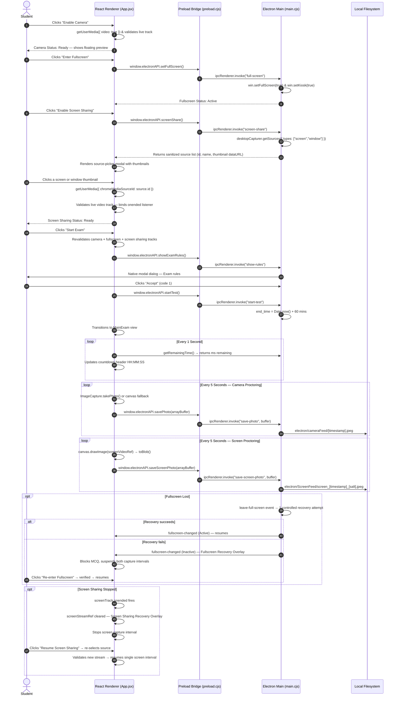

# Athena Exam Desktop Application

A secure, proctored desktop examination application built with **Electron**, **React**, and **Vite**. The application combines native OS lockdown capabilities (frameless kiosk window, native modal dialogs, real-time native fullscreen state verification, periodic background webcam snapshot capture, and mandatory screen sharing via Electron `desktopCapturer`) with a modern React single-page examination interface.

---

## Table of Contents

- [Project Overview](#project-overview)
- [Architecture & Technical Design](#architecture--technical-design)
  - [Process Model & Security Guarantees](#process-model--security-guarantees)
  - [Inter-Process Communication (IPC) Flow](#inter-process-communication-ipc-flow)
- [Mandatory Exam Start — Three-Way Pre-Flight Checklist](#mandatory-exam-start--three-way-pre-flight-checklist)
  - [1. Camera Validation & Proctoring Snapshots](#1-camera-validation--proctoring-snapshots)
  - [2. Native Fullscreen & Kiosk Mode Lockdown](#2-native-fullscreen--kiosk-mode-lockdown)
  - [3. Mandatory Screen Sharing — desktopCapturer Integration (Day 3)](#3-mandatory-screen-sharing--desktopcapturer-integration-day-3)
  - [4. Escape Key Handling, Exit Detection & Controlled Recovery](#4-escape-key-handling-exit-detection--controlled-recovery)
  - [5. Screen Sharing Loss During Active Exam](#5-screen-sharing-loss-during-active-exam)
  - [6. Platform Limitations & Security Notice](#6-platform-limitations--security-notice)
  - [7. Authoritative Exam Timer Synchronization](#7-authoritative-exam-timer-synchronization)
  - [8. MCQ Questionnaire, Answer Persistence & Navigation](#8-mcq-questionnaire-answer-persistence--navigation)
- [Directory Structure](#directory-structure)
- [Electron IPC API Reference](#electron-ipc-api-reference)
- [macOS Permissions Required](#macos-permissions-required)
- [Prerequisites & System Requirements](#prerequisites--system-requirements)
- [Installation & Setup](#installation--setup)
- [Running the Application](#running-the-application)
- [Verification & Automated Test Suite](#verification--automated-test-suite)
- [Known Limitations](#known-limitations)
- [Implementation Status & Roadmap](#implementation-status--roadmap)

---

## Project Overview

The **Athena Exam Desktop Application** provides an academic testing environment that prevents candidates from switching tabs, opening developer utilities, or navigating outside the testing container while taking high-stakes multiple-choice assessments.

The application operates across two distinct domains:

1. **Desktop Native Shell (Electron):** Manages window framing, system-level fullscreen kiosk lockdown, mandatory screen sharing via `desktopCapturer`, proctoring camera frame persistence, native dialog prompts, authoritative countdown timestamps, and bidirectional window state monitoring.
2. **Client Interface (React + Vite):** Delivers a clean, distraction-free user experience styled with pure CSS design tokens, offering candidate permission onboarding, live webcam status, screen-sharing source selection, fullscreen and screen-sharing recovery screens, and interactive questionnaire navigation with answer persistence.

---

## Architecture & Technical Design

### Process Model & Security Guarantees

Electron executes JavaScript in two separate environments: the **Main Process** (Node.js runtime with full OS access) and the **Renderer Process** (Chromium browser sandbox rendering HTML/CSS/React).

```
┌─────────────────────────────────────────────────────────────┐
│               ELECTRON MAIN PROCESS                         │
│                 (electron/main.cjs)                         │
│   • BrowserWindow Native Fullscreen / Kiosk Lockdown        │
│   • Native Window Event Monitoring (enter/leave FS)         │
│   • Controlled Fullscreen Recovery & IPC Broadcast          │
│   • desktopCapturer.getSources() — screen source listing    │
│   • macOS Screen Recording permission check                 │
│   • Local Filesystem IO (electron/cameraFeed/)              │
│   • Local Filesystem IO (electron/ScreenFeed/)              │
│   • Authoritative Exam Epoch Countdown Timer                │
│   • Native System Dialogs (dialog.showMessageBox)           │
└───────────────────────────┬─────────────────────────────────┘
                            │
               contextBridge.exposeInMainWorld
             (Preload: electron/preload.cjs)
                            │
                            ▼
┌─────────────────────────────────────────────────────────────┐
│              REACT RENDERER PROCESS                         │
│                     (Vite 8 + React 19)                     │
│   • 3-Way Mandatory Pre-flight Checklist (App.jsx)          │
│   • Floating Webcam Stream (HTML5 Video Element)            │
│   • Background Camera Proctoring Snapshots (5s Interval)    │
│   • Background Screen Proctoring Snapshots (5s Interval)    │
│   • Source Picker Modal (desktopCapturer thumbnails)        │
│   • Fullscreen Recovery Blocking Overlay                    │
│   • Screen Sharing Recovery Blocking Overlay                │
│   • Interactive MCQ Questionnaire (MainExam.jsx)            │
│   • Question ID-based Answer State Persistence              │
└─────────────────────────────────────────────────────────────┘
```

#### Security Configuration

- **`contextIsolation: true`:** Prevents scripts in the renderer from accessing Node.js internals or the Electron prototype tree.
- **`nodeIntegration: false`:** Guarantees third-party libraries cannot call `require()`, execute shell commands, or access the local filesystem.
- **Explicit API Surface:** Only functions explicitly exposed on `window.electronAPI` inside [`electron/preload.cjs`](file:///Users/amanrajsharma/Desktop/Projects_Final/Desktop_Application/electron/preload.cjs) can trigger main process IPC routines.
- **Path Traversal Prevention:** `save-screen-photo` and `save-photo` IPC handlers use `path.basename()` on all supplied filenames; the renderer cannot specify arbitrary filesystem destinations.
- **Gitignore Protection:** Camera captures (`electron/cameraFeed/`) and screen captures (`electron/ScreenFeed/`) are strictly excluded from version control.

---

### Inter-Process Communication (IPC) Flow



---

## Mandatory Exam Start — Three-Way Pre-Flight Checklist

Before candidates can access the exam questions, **all three** of the following conditions must be verified. The **Start Exam** button remains disabled until all three pass, and each condition is revalidated at the moment the button is clicked.

### 1. Camera Validation & Proctoring Snapshots

- **Hardware Acquisition:** `getUserMedia({ video: true })` — prior streams are stopped before requesting a new one.
- **Track Health Checks:** Asserts `getVideoTracks().length > 0` and `track.readyState === "live"`.
- **Proctoring Snapshots:** 5-second interval during the active exam using `ImageCapture.takePhoto()` with an `<canvas>` fallback.
- **Concurrency Guard:** `isCapturingRef` lock prevents overlapping snapshot operations.
- **Storage:** `electron/cameraFeed/[timestamp].jpeg` — written by the main process via `save-photo` IPC.
- **Cleanup:** Intervals cleared and tracks stopped on exam end or window unmount.

---

### 2. Native Fullscreen & Kiosk Mode Lockdown

- **macOS:** `win.setFullScreen(true)` + `win.setKiosk(true)`.
- **Windows / Linux:** `win.setKiosk(true)` + `win.setFullScreen(true)`.
- **Verification:** `win.isFullScreen() || win.isKiosk()` — state is queried, not assumed.

---

### 3. Mandatory Screen Sharing — desktopCapturer Integration (Day 3)

Screen sharing is a **mandatory** third prerequisite. The application uses Electron's `desktopCapturer` API in the main process and exposes the result to the renderer via a secure IPC bridge.

#### Workflow

1. Candidate clicks **"Enable Screen Sharing"** on the landing page.
2. Renderer calls `window.electronAPI.screenShare()` → IPC channel `"screen-share"`.
3. Main process calls `desktopCapturer.getSources({ types: ["screen", "window"] })`, sanitizes `NativeImage` objects into data URLs, and returns the list.
4. A **source-picker modal** appears with thumbnail previews of all available screens and windows.
5. Candidate clicks a source. Renderer calls:
   ```js
   navigator.mediaDevices.getUserMedia({
     video: { mandatory: { chromeMediaSource: "desktop", chromeMediaSourceId: source.id } }
   })
   ```
6. Renderer validates the returned stream has a live video track.
7. `screenShareStatus` is set to `"Ready"` and the source name is displayed.
8. `track.onended` is bound — if the candidate stops sharing from the OS UI, the application detects this immediately.

#### Security

- The renderer does **not** auto-select a source silently.
- `screenShareStatus` is only marked `"Ready"` after a live stream is confirmed.
- The renderer cannot write directly to `electron/ScreenFeed/` — all file IO goes through the `"save-screen-photo"` IPC handler.

---

### 4. Escape Key Handling, Exit Detection & Controlled Recovery

- **Escape Interception:** `win.webContents.on("before-input-event")` intercepts Escape during active exam with `event.preventDefault()`.
- **Native Exit Monitoring:** `leave-full-screen` and `leave-html-full-screen` events trigger controlled recovery (1 auto-retry after 300ms).
- **Recovery Overlay:** If fullscreen cannot be restored, a blocking overlay appears — MCQ inputs disabled, timer continues, answers preserved.

---

### 5. Screen Sharing Loss During Active Exam

If the shared screen track ends while the exam is active:

- `screenTrack.onended` fires → `screenStreamRef` cleared → `screenShareStatus` → `"Not Ready"`.
- Both screenshot intervals are **suspended** (their `useEffect` dependency arrays include `screenShareStatus`).
- A **Screen Sharing Recovery Overlay** appears, blocking all MCQ interaction.
- **"Resume Screen Sharing"** opens the source-picker again.
- After the candidate selects a new source and the stream is validated, the overlay unmounts and both intervals **resume without duplication**.
- **Exam timer continues and all answers are preserved** throughout.

---

### 6. Platform Limitations & Security Notice

> [!NOTE]
> No application can universally disable OS-level security shortcuts. macOS and Linux prioritize system-level gestures (Mission Control, App Exposé, Cmd+Option+Esc) above user-space applications. Athena implements the strongest enforcement available in user space: `before-input-event` interception, native window event monitoring, controlled auto-recovery, and interaction-blocking overlays.

---

### 7. Authoritative Exam Timer Synchronization

- `end_time` is stored in the Electron main process: `end_time = Date.now() + 60 * 60 * 1000`.
- Re-invoking `start-test` during an active session preserves the existing `end_time` — the timer is never reset during navigation or recovery.
- The renderer polls `getRemainingTime()` every 1000ms and formats into `HH:MM:SS`.
- When remaining time reaches `<= 0`, exam auto-concludes and teardown runs.

---

### 8. MCQ Questionnaire, Answer Persistence & Navigation

- Answers stored by question ID: `{ [questionId]: optionIndex }` — restored on back/forward navigation.
- Bounded pagination: **Previous** disabled at `currentIndex === 0`, **Next** disabled at `currentIndex === totalQuestions - 1`.
- `isBlocked = true` disables all radio inputs, navigation buttons, and end-test trigger during any recovery overlay (fullscreen or screen sharing).

---

## Directory Structure

```text
Desktop_Application/
├── .gitignore                        # Excludes node_modules, dist, cameraFeed/, ScreenFeed/, *.jpeg, *.jpg
├── electron/
│   ├── cameraFeed/                   # Camera proctoring snapshots (git-ignored)
│   ├── ScreenFeed/                   # Screen proctoring snapshots (git-ignored)
│   ├── main.cjs                      # Main process: fullscreen, desktopCapturer, IPC, timer, IO
│   ├── preload.js                    # Canonical preload — contextBridge with all Day 2 + Day 3 APIs
│   └── preload.cjs                   # CommonJS copy used by main.cjs at runtime
├── public/
│   ├── favicon.svg
│   └── icons.svg
├── src/
│   ├── assets/
│   │   ├── hero.png
│   │   ├── react.svg
│   │   └── vite.svg
│   ├── components/
│   │   └── MainExam.jsx              # MCQ with answer persistence & blocked state
│   ├── App.css                       # Styling: statuses, recovery overlays, source picker, cards
│   ├── App.jsx                       # 3-way pre-flight, screen sharing, camera, exam lifecycle
│   ├── index.css
│   └── main.jsx
├── test/
│   ├── exam_enforcement.test.js      # Day 2: 12 automated scenarios
│   └── day3_screen_sharing.test.js   # Day 3: 18 automated scenarios
├── eslint.config.js
├── index.html
├── INTEGRATION_MAP.md
├── package-lock.json
├── package.json
├── PACKAGE_LOG.md
├── README.md
└── vite.config.js
```

---

## Electron IPC API Reference

| Method Name | Channel | Parameters | Returns | Description |
| :--- | :--- | :--- | :--- | :--- |
| `setFullScreen()` | `"full-screen"` | — | `Promise<Object>` | Activates native fullscreen + kiosk; returns verified state. |
| `exitFullScreen()` | `"exit-full-screen"` | — | `Promise<Object>` | Exits fullscreen + kiosk; returns verified state. |
| `getFullscreenStatus()` | `"get-fullscreen-status"` | — | `Promise<Object>` | Queries `isFullScreen()` and `isKiosk()`. |
| `onFullscreenChange(cb)` | `"fullscreen-changed"` | `Function` | `Function` | Subscribes to window state push events; returns unsubscribe function. |
| `showExamRules()` | `"show-rules"` | — | `Promise<number>` | Native modal — `1` = Accept, `0` = Cancel. |
| `showRules()` | `"show-rules"` | — | `Promise<number>` | Alias for `showExamRules()`. |
| `startTest()` | `"start-test"` | — | `Promise<number>` | Sets `end_time`; idempotent — preserves existing epoch. |
| `endTest()` | `"end-test"` | — | `Promise<Object>` | Clears `end_time`, sets `examActive = false`, exits fullscreen. |
| `getRemainingTime()` | `"get-time"` | — | `Promise<number>` | Returns `end_time - Date.now()` in ms. |
| `savePhoto(buf)` | `"save-photo"` | `ArrayBuffer` | `Promise<Object>` | Writes camera snapshot to `electron/cameraFeed/[timestamp].jpeg`. |
| `screenShare(opts?)` | `"screen-share"` | `Object?` | `Promise<Object>` | Calls `desktopCapturer.getSources()`; returns `{ success, sources[] }` with thumbnail data URLs. Checks macOS Screen Recording permission first. |
| `saveScreenPhoto(buf)` | `"save-screen-photo"` | `ArrayBuffer` | `Promise<Object>` | Writes screen snapshot to `electron/ScreenFeed/screen_[ts]_[salt].jpeg`. Path traversal prevented via `path.basename()`. |
| `saveScreenFrame(buf)` | `"save-screen-photo"` | `ArrayBuffer` | `Promise<Object>` | Alias for `saveScreenPhoto`. |

---

## macOS Permissions Required

Athena requires two macOS permissions to operate correctly.

### 1. Camera Access

- **Required for:** Candidate webcam proctoring.
- **Grant via:** System Settings → Privacy & Security → Camera → Enable for **Electron**.

### 2. Screen Recording

- **Required for:** `desktopCapturer.getSources()` to enumerate screens/windows AND `getUserMedia` with `chromeMediaSource: "desktop"` to capture frames.
- **Grant via:** System Settings → Privacy & Security → Screen Recording → Enable for **Electron**.

> [!IMPORTANT]
> If Screen Recording permission is **not** granted, `desktopCapturer.getSources()` will return an empty array. The main process detects `systemPreferences.getMediaAccessStatus("screen") === "denied"` and returns:
>
> *"Screen Recording permission is denied in macOS System Settings. Please enable Screen Recording in System Settings > Privacy & Security > Screen Recording."*
>
> After granting permission, **restart the Electron application** for the change to take effect.

---

## Prerequisites & System Requirements

- **Node.js:** `v18.0.0`+ (tested on `v25.8.2`).
- **npm:** `v9.0.0`+ (tested on `v11.11.1`).
- **Electron:** `^41.7.1` (installed as devDependency).
- **OS:**
  - macOS 11.0 (Big Sur)+ — Camera + Screen Recording permissions required.
  - Windows 10 / 11 (64-bit).
  - Linux (Ubuntu 20.04+, Debian 11+, Fedora 36+).
- **Hardware:** Webcam required; primary display required for `desktopCapturer`.

---

## Installation & Setup

```bash
# 1. Clone
git clone https://github.com/AmanRajSharma001/Desktop_Application.git
cd Desktop_Application

# 2. Install
npm install

# 3. Verify
npm run lint
npm test
npm run build
```

---

## Running the Application

### Development Mode (recommended for Day 3 verification)

**Terminal 1 — Vite dev server (port 5173):**
```bash
npm run dev
```

**Terminal 2 — Electron desktop runtime:**
```bash
npm start
```

### Production Build Mode

```bash
npm run build   # Compile React → dist/
npm start       # Electron falls back to dist/index.html if :5173 unavailable
```

---

## Verification & Automated Test Suite

```bash
npm test
```

Runs **30 tests** across two files using Node's built-in test runner.

### Day 2 — `exam_enforcement.test.js` (12 scenarios)

| # | Scenario | Result |
| :--- | :--- | :--- |
| 1 | Neither prerequisite satisfied → Start Exam blocked | ✅ Pass |
| 2 | Camera ready, fullscreen inactive → blocked | ✅ Pass |
| 3 | Fullscreen active, camera track ended/disabled → blocked | ✅ Pass |
| 4 | Both prerequisites satisfied → allowed | ✅ Pass |
| 5 | Escape during active exam → `preventDefault()` | ✅ Pass |
| 6 | Fullscreen exited via OS gesture → detected | ✅ Pass |
| 7 | Successful fullscreen auto-recovery | ✅ Pass |
| 8 | Failed recovery → MCQ inputs blocked | ✅ Pass |
| 9 | Camera permission denial → descriptive error | ✅ Pass |
| 10 | Camera snapshot → correct file written to `cameraFeed/` | ✅ Pass |
| 11 | Answer persistence across question navigation | ✅ Pass |
| 12 | Exam termination → intervals cleared, tracks stopped | ✅ Pass |

### Day 3 — `day3_screen_sharing.test.js` (18 scenarios)

| # | Scenario | Result |
| :--- | :--- | :--- |
| 1 | Landing page exposes three mandatory requirement sections | ✅ Pass |
| 2 | Start Exam disabled when camera unavailable | ✅ Pass |
| 3 | Start Exam disabled when fullscreen inactive | ✅ Pass |
| 4 | Start Exam disabled when screen sharing not approved | ✅ Pass |
| 5 | Start Exam enabled only when all three verified | ✅ Pass |
| 6 | `window.electronAPI.screenShare` exists; IPC wiring verified in source | ✅ Pass |
| 7 | Desktop sources retrieved and source selected (mock) | ✅ Pass |
| 8 | Valid screen-sharing stream obtained (mock track) | ✅ Pass |
| 9 | Screen snapshot written to `electron/ScreenFeed/` | ✅ Pass |
| 10 | Screen filenames are unique (timestamp + random salt) | ✅ Pass |
| 11 | Camera and screen capture destinations are different paths | ✅ Pass |
| 12 | Screen captures not triggered before exam starts | ✅ Pass |
| 13 | Screen captures stop when screen sharing ends | ✅ Pass |
| 14 | Exam blocks MCQ interaction when screen sharing lost | ✅ Pass |
| 15 | Resuming screen sharing preserves timer and answers | ✅ Pass |
| 16 | Resuming screen sharing creates no duplicate intervals | ✅ Pass |
| 17 | Exam completion stops all loops and releases media | ✅ Pass |
| 18 | Day 2 MCQ, timer, camera, and fullscreen behavior intact | ✅ Pass |

### Manual Verification (Electron Runtime Required)

The following steps require a running Electron instance and macOS Screen Recording permission:

1. `npm run dev` + `npm start` → confirm three requirement cards on landing page.
2. Click **Enable Screen Sharing** → confirm source-picker modal with thumbnails appears.
3. Select a screen → confirm `Screen Sharing Status: Ready` and source name shown.
4. Confirm **Start Exam** is disabled until all three are Ready/Active.
5. Start exam → confirm `electron/ScreenFeed/` receives `screen_[ts]_[salt].jpeg` every 5 s.
6. Confirm `electron/cameraFeed/` receives separate `[ts].jpeg` from camera.
7. Stop sharing from macOS menu bar → confirm Screen Sharing Recovery Overlay appears immediately.
8. Re-share → confirm overlay dismisses, exam resumes, timer unchanged, answers preserved.
9. End exam → confirm both directories receive no further files.

---

## Known Limitations

- **macOS Screen Recording Permission:** `desktopCapturer.getSources()` returns an empty array without this permission. The app detects and reports this but cannot grant it programmatically. Restart Electron after granting.
- **Sandboxed Development Environment:** The sandbox used during Day 3 implementation prevented launching a GUI Electron process. IPC wiring, file-write logic, and lifecycle integration were verified through unit tests and source inspection. Live screenshot capture to `electron/ScreenFeed/` was verified at the filesystem level in tests; full end-to-end runtime verification requires a macOS session with Screen Recording permission granted.
- **`getDisplayMedia` Fallback:** If `chromeMediaSource: "desktop"` constraints fail, the code falls back to `navigator.mediaDevices.getDisplayMedia()`. This shows the browser's native picker instead of the custom source-picker modal.
- **Audio:** Screen sharing captures video only — `audio: false` is set explicitly. Microphone access is not requested.
- **Packaged Builds:** `electron/ScreenFeed/` may not be writable inside a packaged `.app` bundle. The main process falls back to `app.getPath("userData")/ScreenFeed` in that case. Development mode always writes to `electron/ScreenFeed/`.

---

## Implementation Status & Roadmap

### Fully Implemented (Day 1 + Day 2 + Day 3)

- [x] **3-Way Mandatory Pre-Flight Checklist:** Camera, fullscreen, screen sharing — all required, all revalidated at start.
- [x] **Screen Sharing via `desktopCapturer`:** Main process source enumeration, thumbnail preview modal, candidate source selection, renderer stream acquisition with `chromeMediaSource: "desktop"`.
- [x] **`screenShare` Preload IPC Function:** `window.electronAPI.screenShare()` → `ipcMain.handle("screen-share")`.
- [x] **Screen Proctoring Snapshots:** 5 s canvas-capture interval → `electron/ScreenFeed/screen_[ts]_[salt].jpeg`.
- [x] **Separate Capture Pipelines:** Camera → `electron/cameraFeed/`; Screen → `electron/ScreenFeed/`. Independent streams, intervals, filesystem paths.
- [x] **Screen Sharing Loss Recovery:** `track.onended` detection, blocking overlay, re-share workflow, no duplicate intervals.
- [x] **Native Fullscreen Lockdown:** Platform-aware kiosk + fullscreen with native state querying.
- [x] **Fullscreen Exit Detection & Recovery:** Escape interception, controlled auto-recovery (1 retry), blocking overlay.
- [x] **MCQ Answer Persistence:** Stored by question ID, restored on navigation, bounded pagination.
- [x] **Authoritative Timer:** Non-resetting main process epoch, automatic expiry.
- [x] **macOS Permission Check:** `systemPreferences.getMediaAccessStatus("screen")` checked before `getSources()`.
- [x] **Security:** `contextIsolation: true`, `nodeIntegration: false`, path traversal prevention.
- [x] **`.gitignore`:** Excludes `electron/cameraFeed/`, `electron/ScreenFeed/`, `*.jpeg`, `*.jpg`.
- [x] **Automated Tests:** 30 passing scenarios (`npm test`).

### Remaining Work & Future Roadmap

- [ ] **Candidate Identity Onboarding:** Name and University Roll Number (URN) fields before exam start.
- [ ] **Express Backend Integration:** Dynamic questions from `questions.json`, session persistence in `sessions.json`.
- [ ] **Answer Submission & Scoring Engine:** Evaluate answers against key, calculate score.
- [ ] **Summary & Results Dashboard:** End-of-exam review — attempted, correct, wrong, percentage.
- [ ] **Electron Application Packager:** `electron-builder` producing `.dmg`, `.exe` / NSIS, `.AppImage`.

---
