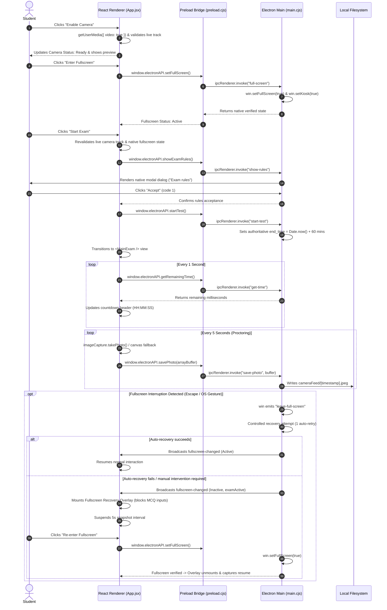

# Athena Exam Desktop Application

A secure, proctored desktop examination application built with **Electron**, **React**, and **Vite**. The application combines native OS lockdown capabilities (frameless kiosk window, native modal dialogs, real-time native fullscreen state verification, and periodic background webcam snapshot capture) with a modern React single-page examination interface.

---

## Table of Contents

- [Project Overview](#project-overview)
- [Architecture & Technical Design](#architecture--technical-design)
  - [Process Model & Security Guarantees](#process-model--security-guarantees)
  - [Inter-Process Communication (IPC) Flow](#inter-process-communication-ipc-flow)
- [Mandatory Exam Start & Fullscreen Enforcement](#mandatory-exam-start--fullscreen-enforcement)
  - [1. Mandatory Pre-Flight Checklist & Validation](#1-mandatory-pre-flight-checklist--validation)
  - [2. Camera Validation & Proctoring Snapshots](#2-camera-validation--proctoring-snapshots)
  - [3. Native Fullscreen & Kiosk Mode Lockdown](#3-native-fullscreen--kiosk-mode-lockdown)
  - [4. Escape Key Handling, Exit Detection & Controlled Recovery](#4-escape-key-handling-exit-detection--controlled-recovery)
  - [5. Platform Limitations & Security Notice](#5-platform-limitations--security-notice)
  - [6. Authoritative Exam Timer Synchronization](#6-authoritative-exam-timer-synchronization)
  - [7. MCQ Questionnaire, Answer Persistence & Navigation](#7-mcq-questionnaire-answer-persistence--navigation)
- [Directory Structure](#directory-structure)
- [Electron IPC API Reference](#electron-ipc-api-reference)
- [Prerequisites & System Requirements](#prerequisites--system-requirements)
- [Installation & Setup](#installation--setup)
- [Running the Application](#running-the-application)
- [Verification & Automated Test Suite](#verification--automated-test-suite)
- [Implementation Status & Roadmap](#implementation-status--roadmap)
  
---

## Project Overview

The **Athena Exam Desktop Application** provides an academic testing environment that prevents candidates from switching tabs, opening developer utilities, or navigating outside the testing container while taking high-stakes multiple-choice assessments.

The application operates across two distinct domains:
1. **Desktop Native Shell (Electron):** Manages window framing, system-level fullscreen kiosk lockdown, proctoring camera frame persistence, native dialog prompts, authoritative countdown timestamps, and bidirectional window state monitoring.
2. **Client Interface (React + Vite):** Delivers a clean, distraction-free user experience styled with pure CSS design tokens, offering candidate permission onboarding, live webcam status, fullscreen recovery screens, and interactive questionnaire navigation with answer persistence.

---

## Architecture & Technical Design

### Process Model & Security Guarantees

Electron executes JavaScript in two separate environments: the **Main Process** (Node.js runtime with full OS access) and the **Renderer Process** (Chromium browser sandbox rendering HTML/CSS/React).

```
┌────────────────────────────────────────────────────────┐
│               ELECTRON MAIN PROCESS                    │
│                 (electron/main.cjs)                    │
│   • BrowserWindow Native Fullscreen / Kiosk Lockdown   │
│   • Native Window Event Monitoring (enter/leave FS)    │
│   • Controlled Fullscreen Recovery & IPC Broadcast     │
│   • Local Filesystem IO (electron/cameraFeed/)         │
│   • Authoritative Exam Epoch Countdown Timer           │
│   • Native System Dialogs (dialog.showMessageBox)      │
└───────────────────────────┬────────────────────────────┘
                            │
               contextBridge.exposeInMainWorld
             (Preload: electron/preload.cjs)
                            │
                            ▼
┌────────────────────────────────────────────────────────┐
│              REACT RENDERER PROCESS                    │
│                     (Vite 8 + React 19)                │
│   • Mandatory Pre-flight Checklist (App.jsx)           │
│   • Floating Webcam Stream (HTML5 Video Element)       │
│   • Background Proctoring Snapshots (5s Interval)      │
│   • Fullscreen Recovery Blocking Overlay               │
│   • Interactive MCQ Questionnaire (MainExam.jsx)       │
│   • Question ID-based Answer State Persistence         │
└────────────────────────────────────────────────────────┘
```

#### Security Configuration:
- **`contextIsolation: true`:** Prevents scripts running in the renderer window from gaining direct access to Node.js internals or the Electron internal prototype tree.
- **`nodeIntegration: false`:** Guarantees that third-party web libraries or remote content cannot call `require()`, execute shell commands, or access the local file system.
- **Explicit API Surface:** Only functions explicitly exposed on `window.electronAPI` inside [`electron/preload.cjs`](file:///Users/amanrajsharma/Desktop/Projects_Final/Desktop_Application/electron/preload.cjs) can trigger main process IPC routines.
- **Gitignore Protection:** Proctored camera captures stored in `electron/cameraFeed/` and any `Captures/` paths are strictly excluded from version control.

---

### Inter-Process Communication (IPC) Flow



---

## Mandatory Exam Start & Fullscreen Enforcement

### 1. Mandatory Pre-Flight Checklist & Validation

Before candidates can access the exam questions, they are greeted with the mandatory onboarding directive:

> **Before starting the exam, you must enable your camera and enter fullscreen. Both are mandatory.**

The setup dashboard renders dedicated interactive controls with explicit status badges:
- **Enable Camera:** Invokes `navigator.mediaDevices.getUserMedia({ video: true })` and mounts a floating preview.
- **Camera Status:** Displays `Not Ready`, `Ready`, or `Error` (with detailed diagnostic information on permission denial or missing hardware).
- **Enter Fullscreen:** Invokes native Electron window fullscreen/kiosk mode.
- **Fullscreen Status:** Displays `Inactive`, `Active`, or `Error`.
- **Start Exam:** Strictly disabled until both `cameraStatus === "Ready"` and `fullscreenStatus === "Active"`.

#### Strict Pre-Flight Revalidation:
When the candidate clicks **Start Exam**, the application executes a second synchronous pre-flight revalidation:
1. Verifies that the camera stream and active video track are still live (`track.readyState === "live" && track.enabled`).
2. Queries the native Electron window state via `window.electronAPI.getFullscreenStatus()`.

If either check fails (e.g., webcam disconnected or fullscreen dropped between setup and start), the exam does **not** start, the candidate remains on the setup screen, and an explanatory resolution banner is displayed.

---

### 2. Camera Validation & Proctoring Snapshots

- **Hardware Acquisition:** Camera access is acquired through standard WebRTC APIs. Before requesting a new stream, any prior streams are stopped to prevent resource leaks or duplicate hardware handles.
- **Track Health Checks:** The application asserts that `stream.getVideoTracks().length > 0` and `track.readyState === "live"`.
- **Proctoring Snapshots:** Once the exam starts, an automated interval captures a snapshot every **5000 milliseconds**.
- **Resilient Fallback Pipeline:** Snapshots use the W3C `ImageCapture` API (`takePhoto()`), with an automated fallback to an off-screen HTML5 `<canvas>` buffer capture if `takePhoto()` is unsupported or throws an error.
- **Concurrency Guard:** An `isCapturing` lock ensures overlapping snapshot requests are skipped if disk IO or network delays exceed the interval.
- **Storage & Sanitization:** Snapshot buffers are saved by the main process to `electron/cameraFeed/[timestamp].jpeg`. File write errors are caught safely and returned as structured responses.
- **Lifecycle Cleanup:** When the assessment finishes or the window unmounts, snapshot intervals are cleared and all media tracks are stopped via `track.stop()`.

---

### 3. Native Fullscreen & Kiosk Mode Lockdown

Rather than relying on renderer-only CSS tricks or setting dummy JavaScript properties such as `win.kiosk = true`, Athena calls Electron's native `BrowserWindow` APIs:

- **macOS (`darwin`):** Calls `win.setFullScreen(true)` (native macOS Space fullscreen) and `win.setKiosk(true)` (locks out the macOS dock and menu bar).
- **Windows / Linux:** Calls `win.setKiosk(true)` and `win.setFullScreen(true)` to hide the OS taskbar and window decorations.
- **Native Verification:** Window state is verified via `win.isFullScreen() || win.isKiosk()`.

---

### 4. Escape Key Handling, Exit Detection & Controlled Recovery

- **Escape Interception:** Electron's main process listens to `win.webContents.on("before-input-event")`. When `input.key === "Escape"` and an exam is active, default Chromium fullscreen dismissal is intercepted with `event.preventDefault()`.
- **Native Exit Monitoring:** The main process binds listeners to `leave-full-screen` and `leave-html-full-screen`. If the candidate uses native OS gestures (e.g., trackpad swipe, Mission Control, or OS key combinations) to leave fullscreen:
  1. **Controlled Recovery:** The main process initiates **one** controlled recovery attempt after a 300ms transition delay to re-assert fullscreen.
  2. **Loop Prevention:** Automatic recovery is strictly capped (`MAX_AUTO_RECOVERY = 1`) to prevent endless loops or focus-stealing wars.
  3. **Recovery Screen Overlay:** If fullscreen remains unverified, the main process broadcasts `fullscreen-changed: { isActive: false, examActive: true }`. The React UI displays a blocking modal overlay:
     - Question navigation and radio inputs are disabled.
     - Snapshot intervals are suspended.
     - The authoritative exam timer continues without resetting.
     - A **Re-enter Fullscreen** button allows the candidate to re-verify fullscreen and resume their assessment.

---

### 5. Platform Limitations & Security Notice

> [!NOTE]
> **Operating System Limitations:**
> No application can universally disable OS-level security shortcuts. Operating systems like macOS and Linux prioritize system-level gestures (such as Mission Control, App Exposé, or Cmd+Option+Esc) and display manager hotkeys above user-space applications. Athena implements the strongest reasonable enforcement available in user space by combining `before-input-event` interception, native window event monitoring, controlled auto-recovery, and an interaction-blocking recovery overlay.

---

### 6. Authoritative Exam Timer Synchronization

- **Server/Process Authoritative:** To prevent client-side clock tampering, `end_time` is stored on the Electron main process: `end_time = Date.now() + 60 * 60 * 1000`.
- **Idempotent Start:** If `start-test` is invoked again during the exam session, the existing `end_time` is preserved, ensuring the timer is never reset during question navigation or fullscreen recovery.
- **Polling & Format:** The renderer polls `window.electronAPI.getRemainingTime()` every 1000ms and formats milliseconds into `HH:MM:SS`.
- **Automatic Expiry:** When remaining time reaches `<= 0`, the exam automatically concludes and triggers teardown.

---

### 7. MCQ Questionnaire, Answer Persistence & Navigation

- **Answer State Persistence:** Selected answers are stored in a state dictionary mapped by question ID (`{ [questionId]: optionIndex }`). Navigating forward or backward restores the candidate's previously selected option without data loss.
- **Dynamic Question Count:** The progress display (`Question X of Y`) and navigation boundaries adapt dynamically to `questions.length`.
- **Bounded Pagination:** **Previous** is disabled on the first question (`currentIndex === 0`), and **Next** is disabled on the final question (`currentIndex === totalQuestions - 1`).
- **Blocked State Handling:** When fullscreen recovery is active (`isBlocked = true`), all radio inputs, navigation buttons, and end-test triggers are disabled.

---

## Directory Structure

```text
Desktop_Application/
├── .gitignore                   # Excludes logs, node_modules, build, and cameraFeed/
├── electron/
│   ├── cameraFeed/              # Proctoring snapshot directory (ignored by git)
│   ├── main.cjs                 # Main process (Native fullscreen, IPC, timer, snapshot IO)
│   └── preload.cjs              # Secure contextBridge exposing window.electronAPI
├── public/
│   ├── favicon.svg              # Athena desktop favicon
│   └── icons.svg                # Application SVG symbol definitions
├── src/
│   ├── assets/                  # Hero branding illustrations and SVG logos
│   │   ├── hero.png
│   │   ├── react.svg
│   │   └── vite.svg
│   ├── components/
│   │   └── MainExam.jsx         # MCQ container with answer persistence & blocked state
│   ├── App.css                  # Athena styling (statuses, recovery overlay, cards)
│   ├── App.jsx                  # Pre-flight onboarding, camera capture & view coordinator
│   ├── index.css                # Global CSS variables, layout tokens, and typography
│   └── main.jsx                 # React DOM mount point
├── test/
│   └── exam_enforcement.test.js # Automated test suite verifying 12 exam scenarios
├── eslint.config.js             # ESLint config covering React and Node environments
├── index.html                   # HTML host document
├── INTEGRATION_MAP.md           # Granular file tracking against upstream references
├── package-lock.json            # Dependency lockfile
├── package.json                 # Project configuration and scripts
├── PACKAGE_LOG.md               # Package audit log
├── README.md                    # Project documentation
└── vite.config.js               # Vite bundler configuration
```

---

## Electron IPC API Reference

| Method Name | Channel Name | Parameters | Returns | Description |
| :--- | :--- | :--- | :--- | :--- |
| `setFullScreen()` | `"full-screen"` | `void` | `Promise<Object>` | Activates native fullscreen and kiosk mode; returns verified window state. |
| `exitFullScreen()` | `"exit-full-screen"` | `void` | `Promise<Object>` | Exits native fullscreen and kiosk mode; returns verified window state. |
| `getFullscreenStatus()` | `"get-fullscreen-status"` | `void` | `Promise<Object>` | Queries native `isFullScreen()` and `isKiosk()` window properties. |
| `onFullscreenChange(cb)` | `"fullscreen-changed"` | `Function` | `Function` | Subscribes to window state broadcasts; returns an unsubscribe function. |
| `showExamRules()` | `"show-rules"` | `void` | `Promise<number>` | Displays native modal dialog with code of conduct rules (`1` = Accept, `0` = Cancel). |
| `showRules()` | `"show-rules"` | `void` | `Promise<number>` | Backward-compatibility alias for `showExamRules()`. |
| `startTest()` | `"start-test"` | `void` | `Promise<number>` | Initializes authoritative 60-minute countdown epoch; preserves existing epoch if already set. |
| `endTest()` | `"end-test"` | `void` | `Promise<Object>` | Deactivates active exam state, resets timer epoch, and exits fullscreen mode. |
| `getRemainingTime()` | `"get-time"` | `void` | `Promise<number>` | Returns remaining test duration in milliseconds (`end_time - Date.now()`). |
| `savePhoto(buffer)` | `"save-photo"` | `ArrayBuffer` | `Promise<Object>` | Safely writes snapshot bytes to `electron/cameraFeed/[timestamp].jpeg`. |

---

## Prerequisites & System Requirements

- **Node.js:** `v18.0.0` or higher (tested on Node.js `v25.8.2`).
- **npm:** `v9.0.0` or higher (tested on npm `11.11.1`).
- **Operating System:**
  - macOS 11.0 (Big Sur) or higher (Apple Silicon & Intel).
  - Windows 10 / 11 (64-bit).
  - Linux (Ubuntu 20.04+, Debian 11+, Fedora 36+).
- **Hardware:** Webcam / video device required for proctoring checks.

---

## Installation & Setup

1. **Clone the repository:**
   ```bash
   git clone https://github.com/AmanRajSharma001/Desktop_Application.git
   cd Desktop_Application
   ```

2. **Install exact dependencies:**
   ```bash
   npm install
   ```

3. **Verify linting, tests, and build:**
   ```bash
   npm run lint
   npm test
   npm run build
   ```

---

## Running the Application

### Option 1: Development Mode (Hot Module Replacement)

Run the Vite frontend development server and the Electron desktop application concurrently:

**Terminal 1 (Vite Dev Server on port 5173):**
```bash
npm run dev
```

**Terminal 2 (Electron Desktop Runtime):**
```bash
npm start
```

### Option 2: Standalone / Production Build Mode

Build the React frontend into static assets. The Electron main process automatically falls back to [`dist/index.html`](file:///Users/amanrajsharma/Desktop/Projects_Final/Desktop_Application/dist/index.html) if `http://localhost:5173/` is unreachable:

```bash
# 1. Compile production bundle
npm run build

# 2. Launch desktop application
npm start
```

---

## Verification & Automated Test Suite

The repository includes an automated test suite executed via Node.js's native test runner (`node --test`), verifying all 12 mandatory exam scenarios:

```bash
npm test
```

### Verified Test Matrix:

| # | Scenario | Verification Result | Details |
| :--- | :--- | :--- | :--- |
| **1** | Starting with neither prerequisite satisfied | Passed | Start Exam is blocked; descriptive error message generated. |
| **2** | Camera ready but fullscreen inactive | Passed | Blocked until native fullscreen is verified. |
| **3** | Fullscreen active but camera unavailable | Passed | Blocked when video track is missing, ended, or disabled. |
| **4** | Starting after both prerequisites are satisfied | Passed | Pre-flight check passes and proceeds to rules dialog & exam start. |
| **5** | Pressing Escape during the active exam | Passed | `before-input-event` intercepts Escape and calls `preventDefault()`. |
| **6** | Exiting fullscreen through external OS mechanism | Passed | Detected by native window listeners (`leave-full-screen`). |
| **7** | Successful fullscreen recovery | Passed | Controlled auto-recovery restores fullscreen without resetting timer. |
| **8** | Failed fullscreen recovery and blocked interaction | Passed | Blocks MCQ inputs, disables navigation, mounts recovery overlay. |
| **9** | Camera permission denial or hardware failure | Passed | Formats helpful diagnostic errors for `NotAllowedError`/`NotFoundError`. |
| **10** | Camera capture and correct file storage | Passed | Writes buffer to `electron/cameraFeed/` with timestamp `.jpeg`. |
| **11** | Answer persistence during question navigation | Passed | Answers stored by question ID; preserved when moving back and forth. |
| **12** | Exam termination and hardware cleanup | Passed | Clears intervals, stops camera tracks, and resets timer epoch. |

---

## Implementation Status & Roadmap

### What Is Fully Implemented & Working Today
- [x] **Mandatory Exam Start Checklist:** Clear notice, live camera preview, native fullscreen activation, status badges, and strict pre-flight revalidation.
- [x] **Native Fullscreen Lockdown:** Platform-aware `setFullScreen(true)` and `setKiosk(true)` with native window state querying.
- [x] **Exit Detection & Recovery:** Interception of Escape where supported, native exit detection, controlled auto-recovery (1 retry), and blocking recovery screen.
- [x] **Proctoring Snapshots:** 5-second interval during active verified exam, HTML5 canvas fallback, concurrency lock, and disk IO error handling.
- [x] **MCQ Answer Persistence:** Answers stored by question ID, restored upon navigation, bounded pagination, and dynamic question count.
- [x] **Authoritative Timer Synchronization:** Non-resetting main process countdown epoch with automatic expiry.
- [x] **Automated Test Suite:** 12 automated test scenarios verifying validation, lifecycle, and recovery.

### Remaining Work & Future Roadmap
- [ ] **Candidate Identity Onboarding:** Integrating student registration fields (`Name` and University Roll Number `URN`) before starting the exam.
- [ ] **Integrated Express Backend Service:** Embedding or connecting the Express API service (`server.js`) to serve dynamic questions from `questions.json` and persist candidate sessions in `sessions.json`.
- [ ] **Answer Submission & Scoring Engine:** Recording selected option indices, evaluating answers against the question bank answer key, and calculating scores.
- [ ] **Summary & Results Dashboard:** Rendering an end-of-exam review screen showing questions attempted, correct answers, wrong answers, and overall percentage.
- [ ] **Electron Application Packager:** Configuring `electron-builder` to package standalone native installers (`.dmg` for macOS, `.exe` / NSIS for Windows, `.AppImage` for Linux).

---
